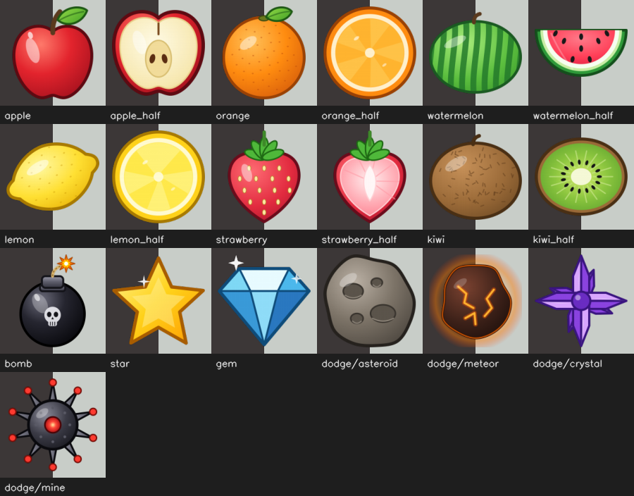

# Development guide

## Setup

```bash
pip install -r requirements-dev.txt    # runtime dependencies + ruff, pyinstaller, cairosvg
ruff check .                           # lint
ruff format .                          # format
```

## Project structure

```
handarcade/
├── main.py                        # entry point: calls engine.menu.run_menu()
├── download_models.py             # fetches the MediaPipe model into engine/models/
├── generate_placeholder_sounds.py # creates simple sound effects
├── handarcade.spec                # PyInstaller build config
├── requirements.txt               # runtime dependencies
├── requirements-dev.txt           # + ruff, pyinstaller, cairosvg
├── ruff.toml
├── assets/                        # sprites, sounds, music
├── art/                           # editable SVG sources and preview.png
├── tools/build_art.py             # draws the sprites and renders them to assets/
├── docs/                          # game guide and this guide
├── engine/                        # shared code used by every game
│   ├── menu.py, menu_draw.py, menu_input.py, menu_state.py   # the menu
│   ├── camera.py                  # camera setup, fullscreen display, tracking frame
│   ├── tracking.py                # MediaPipe hand tracking wrapper
│   ├── audio.py                   # sound effects, music, saved volume
│   ├── sprites.py                 # PNG drawing with alpha, rotation, caching
│   ├── hud.py                     # shared HUD: score, popups, game-over screen
│   ├── select_screen.py           # difficulty-select screen
│   ├── transitions.py             # fade between screens
│   ├── highscores.py              # saved best scores
│   ├── smoothing.py               # frame-rate-aware smoothing
│   ├── layout.py                  # resolution scaling
│   ├── paths.py                   # asset and user-data paths (also for packaged builds)
│   └── models/                    # hand_landmarker.task (downloaded)
└── games/
    ├── fruit_slice/               # game, fruit, spawner, difficulty, hud
    ├── dodge/                     # game, player, obstacles, collision, difficulty, config, hud
    ├── catch/                     # game, paw, spawner, objects, hud
    └── pinch_pop/                 # game, bubbles, effects, score, hud
```

## Tuning

| To change | Edit |
| --- | --- |
| Fruit Slice lives, spawn rate, bombs, speed | `games/fruit_slice/difficulty.py` |
| Dodge speed, chasers, swarms, fairness rules | `games/dodge/config.py` |
| Catch spawn rate and fall speed | `games/catch/spawner.py` |
| Catch object types and sizes | `games/catch/objects.py` |
| Pinch Pop bubble kinds and scoring | `games/pinch_pop/bubbles.py`, `score.py` |
| How easily a pinch registers | `PINCH_ENTER_RATIO`, `PINCH_EXIT_RATIO` in `games/pinch_pop/effects.py` |
| Camera resolution | `_CANDIDATE_RESOLUTIONS` in `engine/camera.py` |

All sizes and speeds are written for a 720-pixel-tall frame and scaled to the
real camera automatically (`engine/layout.py`), so the games play the same at 720p
and 1080p. If everything looks too big or too small, change `REF_HEIGHT` there.

## Adding a game

1. Create `games/your_game/` with a function `run_your_game(cap, tracker)`.
2. It runs its own loop: read frames from `cap`, process them with `tracker`,
   draw, and display with `engine.camera.show(WINDOW_NAME, frame)`.
3. Return `"quit"` to close the app, or anything else (for example `"menu"`) to
   go back to the menu.
4. Add it to the `GAMES` list in `engine/menu.py`.

Useful helpers:

- `engine.camera.to_tracking_frame()`: a small, aspect-correct frame for MediaPipe
- `engine.layout.ui_scale()`: resolution scaling
- `engine.hud`: score, popups, text and the game-over screen
- `engine.select_screen`: difficulty selection
- `engine.highscores` and `engine.audio`: saved scores and sound

The existing games are working examples of each.

## Art

All sprites are vector art drawn in code and rendered to transparent PNGs.



- Edit a sprite's function in `tools/build_art.py`, then run
  `python tools/build_art.py`. It rewrites `assets/` and `art/preview.png`.
- Or open the files in `art/svg/` with Inkscape or Figma and export a PNG with
  the same name into `assets/`.
- Keep sprites roughly square and trimmed to their edges: the games use the image
  size as the hit area. They are authored at twice their 720p size so they stay
  sharp at 1080p.
- To add a sprite, write a function that returns an SVG, add it to the `SPRITES`
  table in the build script, and point a game at the new file.

`baste.png` and `baz.png` are hand-drawn and are never touched by the build script.
A missing sprite never crashes a game: it is drawn as a plain shape instead.

## Building a standalone app

```bash
pyinstaller handarcade.spec
```

The app appears in `dist/HandArcade/`. The spec keeps a console window open
(`console=True`) so you can see errors; set it to `False` once the build works.

Running from source is tested on Windows and macOS. The packaged build is tested
on Windows only. A packaged macOS app also needs a camera-permission entry
(`NSCameraUsageDescription`) in its bundle.

## Where user data is saved

Settings and high scores are stored per user, not in the project folder, so they
survive packaging. Delete the folder to reset them.

| OS | Folder |
| --- | --- |
| Windows | `%APPDATA%\HandArcade` |
| macOS | `~/Library/Application Support/HandArcade` |
| Linux | `~/.config/HandArcade` |

It contains `audio_settings.json` and `highscores.json`.